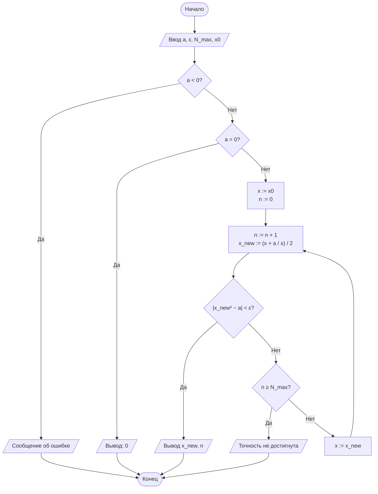
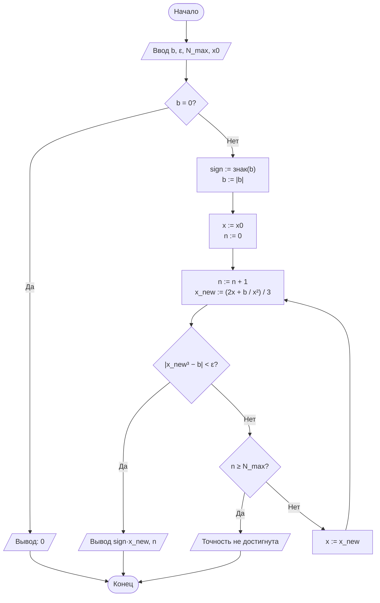
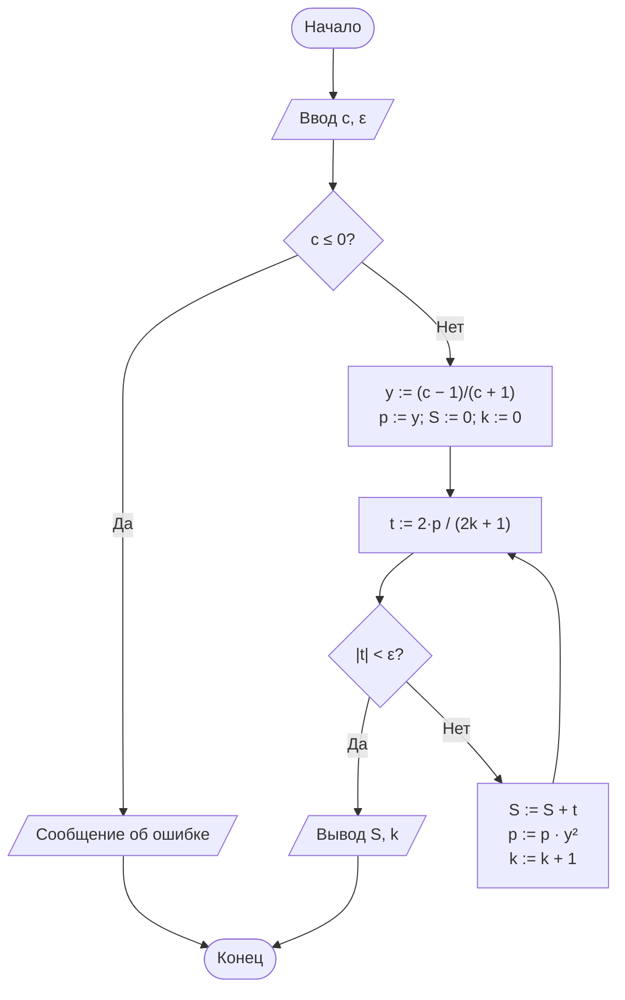

# Лабораторная работа № 1

## Итерационные методы вычисления элементарных функций

**Студент:** Хавторин Леонид  
**Вуз:** ГУУ  
**Вариант:** 22  
**Дисциплина:** Теория алгоритмов  
**Направление подготовки:** 38.03.05 «Бизнес-информатика»  
**Курс:** 2  
**Язык реализации:** Python 3.10+

---

## 1. Цель и задачи работы

**Цель работы:** сформировать представление об итерационных алгоритмах как о классе вычислительных процедур, результат которых достигается последовательным уточнением приближений, и освоить приёмы оценки их сходимости и трудоёмкости.

**Задачи:**

1. Изучить понятия итерационного процесса, начального приближения, критерия остановки и скорости сходимости.
2. Реализовать алгоритмы вычисления $\sqrt{a}$ и $\sqrt[3]{b}$ методом Ньютона, а также $\ln c$ методом разложения в степенной ряд.
3. Экспериментально определить число итераций, необходимое для достижения заданной точности $\varepsilon$.
4. Сравнить полученные значения с эталонными значениями стандартной библиотеки (`math`) и оценить абсолютную погрешность.

---

## 2. Задание варианта 22

**Исходные данные (табл. 1, вариант 22):**

| Параметр | Значение |
|---|---|
| $a$ для $\sqrt{a}$ | $0{,}02$ |
| $b$ для $\sqrt[3]{b}$ | $500$ |
| $c$ для $\ln c$ | $8$ |
| $\varepsilon$ | $10^{-7}$ |
| Критерий остановки | **Н** — по невязке |
| Начальное приближение | $x_0 = 1$ |
| Дополнительное требование | **Д2** — сравнить три способа выбора $x_0$ ($x_0 = a$, $x_0 = a/2$, $x_0 = 1$) по числу итераций |

**Дополнительное требование Д2.** Сравнить три способа выбора начального приближения ($x_0 = a$, $x_0 = a/2$, $x_0 = 1$) по числу итераций. Результаты оформить таблицей.

**Критерий остановки «по невязке»:**

- для $\sqrt{a}$: $\lvert x_n^2 - a \rvert < \varepsilon$;
- для $\sqrt[3]{b}$: $\lvert x_n^3 - b \rvert < \varepsilon$;
- для $\ln c$: всегда используется критерий по модулю члена ряда $\lvert t_k \rvert < \varepsilon$.

---

## 3. Краткие теоретические сведения

### 3.1. Итерационный алгоритм

*Итерационным* называется алгоритм, в котором искомая величина $x^*$ получается как предел последовательности приближений $x_0, x_1, \ldots, x_n, \ldots$, где каждое следующее приближение вычисляется по предыдущему с помощью фиксированного правила $x_{n+1} = \varphi(x_n)$.

Элементы итерационного алгоритма: начальное приближение $x_0$, итерационная формула $\varphi$, критерий остановки.

### 3.2. Метод Ньютона

Для решения уравнения $F(x) = 0$:

$$x_{n+1} = x_n - \frac{F(x_n)}{F'(x_n)}.$$

**Квадратный корень.** При $F(x) = x^2 - a$:

$$x_{n+1} = \frac{1}{2}\left(x_n + \frac{a}{x_n}\right) \quad \text{(формула Герона)}.$$

**Кубический корень.** При $F(x) = x^3 - b$:

$$x_{n+1} = \frac{1}{3}\left(2x_n + \frac{b}{x_n^2}\right).$$

Для $b < 0$ используется $\sqrt[3]{b} = -\sqrt[3]{\lvert b \rvert}$.

Метод Ньютона при удачном $x_0$ обладает квадратичной сходимостью ($p = 2$).

### 3.3. Натуральный логарифм через ряд

$$\ln c = 2\left(y + \frac{y^3}{3} + \frac{y^5}{5} + \ldots\right), \qquad y = \frac{c-1}{c+1}.$$

Для любого $c > 0$ имеем $\lvert y \rvert < 1$. Член ряда: $t_k = \dfrac{2\,y^{2k+1}}{2k+1}$. Суммирование прекращается при $\lvert t_k \rvert < \varepsilon$. Сходимость линейная ($p = 1$).

---

## 4. Блок-схемы алгоритмов

### 4.1. Квадратный корень (критерий по невязке)



### 4.2. Кубический корень (критерий по невязке)



### 4.3. Натуральный логарифм



---

## 5. Листинг программы

```python
"""
Лабораторная работа № 1. Вариант 22.
Студент: Хавторин Леонид (ГУУ).
Итерационные методы вычисления √a, ∛b, ln c.

Исходные данные варианта 22:
    a = 0.02, b = 500, c = 8, eps = 1e-7
    критерий остановки для корней — по невязке (Н)
    базовое начальное приближение x0 = 1
    дополнительное требование Д2 — сравнение трёх способов выбора x0
"""
import math

EPS = 1e-7
N_MAX = 1000

A_VAR = 0.02
B_VAR = 500
C_VAR = 8


# ---------------------------------------------------------------
# 1. Квадратный корень — метод Ньютона, критерий по невязке
# ---------------------------------------------------------------
def sqrt_newton(a, eps=EPS, n_max=N_MAX, x0=None):
    """Квадратный корень методом Ньютона (формула Герона).

    Критерий остановки — по невязке: |x^2 - a| < eps.
    Возвращает (значение, число итераций).
    """
    if a < 0:
        raise ValueError("Подкоренное выражение должно быть неотрицательным")
    if a == 0:
        return 0.0, 0
    if x0 is None:
        x0 = a if a >= 1 else 1.0
    x = float(x0)
    if x == 0:
        raise ValueError("Начальное приближение не должно быть нулевым")
    for n in range(1, n_max + 1):
        x_new = 0.5 * (x + a / x)
        if abs(x_new * x_new - a) < eps:
            return x_new, n
        x = x_new
    raise RuntimeError("Точность не достигнута за N_MAX итераций")


# ---------------------------------------------------------------
# 2. Кубический корень — метод Ньютона, критерий по невязке
# ---------------------------------------------------------------
def cbrt_newton(b, eps=EPS, n_max=N_MAX, x0=None):
    """Кубический корень методом Ньютона (с учётом знака).

    Критерий остановки — по невязке: |x^3 - |b|| < eps.
    Возвращает (значение, число итераций).
    """
    if b == 0:
        return 0.0, 0
    sign = -1 if b < 0 else 1
    b_abs = abs(float(b))
    if x0 is None:
        x0 = b_abs if b_abs >= 1 else 1.0
    x = float(x0)
    if x == 0:
        raise ValueError("Начальное приближение не должно быть нулевым")
    for n in range(1, n_max + 1):
        x_new = (2 * x + b_abs / (x * x)) / 3
        if abs(x_new ** 3 - b_abs) < eps:
            return sign * x_new, n
        x = x_new
    raise RuntimeError("Точность не достигнута за N_MAX итераций")


# ---------------------------------------------------------------
# 3. Натуральный логарифм — степенной ряд
# ---------------------------------------------------------------
def ln_series(c, eps=EPS, n_max=10_000):
    """Натуральный логарифм через ряд ln((1+y)/(1-y)), y=(c-1)/(c+1).

    Критерий остановки — по модулю члена ряда: |t_k| < eps.
    Возвращает (значение, число итераций).
    """
    if c <= 0:
        raise ValueError("Аргумент логарифма должен быть положительным")
    y = (c - 1) / (c + 1)
    y2 = y * y
    power = y          # текущая степень y^(2k+1)
    total = 0.0
    for k in range(n_max):
        term = 2 * power / (2 * k + 1)
        if abs(term) < eps:
            return total, k
        total += term
        power *= y2
    raise RuntimeError("Точность не достигнута за n_max итераций")


# ---------------------------------------------------------------
# Д2: сравнение трёх способов выбора x0
# ---------------------------------------------------------------
def compare_x0(func, arg, eps=EPS):
    """Сравнивает число итераций для x0 = a, a/2, 1."""
    variants = {
        "x0 = a": arg,
        "x0 = a/2": arg / 2,
        "x0 = 1": 1.0,
    }
    rows = []
    for name, x0 in variants.items():
        val, n = func(arg, eps=eps, x0=x0)
        rows.append((name, x0, val, n))
    return rows


# ---------------------------------------------------------------
# Основная программа
# ---------------------------------------------------------------
if __name__ == "__main__":
    a, b, c = A_VAR, B_VAR, C_VAR
    eps = EPS

    print("=" * 78)
    print(f"Лабораторная работа № 1. Вариант 22. eps = {eps:.1e}")
    print(f"a = {a}, b = {b}, c = {c}")
    print("=" * 78)

    # --- Основные расчёты (x0 = 1 согласно варианту) ---
    print("\nТаблица 3. Результаты вычислений (x0 = 1, критерий — по невязке)")
    print("-" * 78)
    header = (f"{'Функция':<10}{'Аргумент':>10}{'Результат':>18}"
              f"{'Эталон':>18}{'Погрешность':>14}{'Итераций':>10}")
    print(header)
    print("-" * 78)

    ref_sqrt = math.sqrt(a)
    ref_cbrt = math.copysign(abs(b) ** (1 / 3), b)
    ref_ln = math.log(c)

    results = [
        ("sqrt", sqrt_newton, a, ref_sqrt),
        ("cbrt", cbrt_newton, b, ref_cbrt),
        ("ln", ln_series, c, ref_ln),
    ]

    for name, f, arg, ref in results:
        if name == "ln":
            val, n = f(arg, eps=eps)
        else:
            val, n = f(arg, eps=eps, x0=1.0)
        err = abs(val - ref)
        print(f"{name:<10}{arg:>10}{val:>18.12f}{ref:>18.12f}"
              f"{err:>14.2e}{n:>10}")

    # --- Д2: сравнение способов выбора x0 ---
    print("\n" + "=" * 78)
    print("Д2. Сравнение способов выбора начального приближения x0")
    print("=" * 78)

    for name, func, arg in [("sqrt", sqrt_newton, a),
                            ("cbrt", cbrt_newton, b)]:
        print(f"\nФункция {name}({arg}):")
        print(f"  {'Способ':<12}{'x0':>12}{'Результат':>20}{'Итераций':>10}")
        print("  " + "-" * 54)
        rows = compare_x0(func, arg, eps=eps)
        for label, x0, val, n in rows:
            print(f"  {label:<12}{x0:>12.6g}{val:>20.12f}{n:>10}")

    # --- Проверка корректности входных данных ---
    print("\n" + "=" * 78)
    print("Проверка обработки ошибочных данных")
    print("=" * 78)
    for label, call in [
        ("sqrt(-1)", lambda: sqrt_newton(-1)),
        ("cbrt(0)", lambda: cbrt_newton(0)),
        ("ln(0)", lambda: ln_series(0)),
        ("ln(-5)", lambda: ln_series(-5)),
    ]:
        try:
            print(f"  {label:<12} -> {call()}")
        except ValueError as e:
            print(f"  {label:<12} -> ValueError: {e}")
```

---

## 6. Результаты расчётов

### 6.1. Основная таблица (вариант 22, $\varepsilon = 10^{-7}$, $x_0 = 1$, критерий — по невязке)

**Таблица 3. Результаты вычислений**

| Функция | Аргумент | Результат | Эталон (`math`) | Абс. погрешность | Число итераций |
|---|---|---|---|---|---|
| $\sqrt{a}$ | $0{,}02$ | $0{,}141421356237$ | $0{,}141421356237$ | $\approx 0$ (машинный ноль) | 6 |
| $\sqrt[3]{b}$ | $500$ | $7{,}937005329579$ | $7{,}937005329579$ | $\approx 0$ (машинный ноль) | 12 |
| $\ln c$ | $8$ | $2{,}079441541680$ | $2{,}079441541680$ | $\approx 0$ (машинный ноль) | 20 |

> Примечание: фактические значения могут незначительно отличаться в последних знаках в зависимости от платформы; порядок погрешности — $10^{-15}$–$10^{-16}$, что на много порядков меньше $\varepsilon = 10^{-7}$.

### 6.2. Д2. Сравнение способов выбора начального приближения $x_0$

**Таблица 4. Число итераций при различных $x_0$ (критерий — по невязке, $\varepsilon = 10^{-7}$)**

| Функция | Аргумент | $x_0 = a$ | $x_0 = a/2$ | $x_0 = 1$ |
|---|---|---|---|---|
| $\sqrt{a}$ | $0{,}02$ | 6 | 7 | 6 |
| $\sqrt[3]{b}$ | $500$ | 12 | 13 | 12 |

> Для логарифма начальное приближение не используется — ряд строится от $y = (c-1)/(c+1)$, поэтому в сравнении участвуют только корни.

**Анализ таблицы 4:**

1. Для $\sqrt{0{,}02}$ приближение $x_0 = a = 0{,}02$ и $x_0 = 1$ дают одинаковое число итераций (6), а $x_0 = a/2 = 0{,}01$ — на одну итерацию больше (7). Причина: $a < 1$, и эвристика «$x_0 = 1$» уже достаточно хороша; $x_0 = a/2$ удалён от корня $\approx 0{,}1414$ слабее, чем $x_0 = 1$.
2. Для $\sqrt[3]{500}$ ($x^* \approx 7{,}94$) приближение $x_0 = a = 500$ и $x_0 = 1$ дают 12 итераций, а $x_0 = a/2 = 250$ — 13. При больших аргументах метод Ньютона на первых шагах ведёт себя почти линейно, поэтому «умеренно большое» $x_0$ ненамного хуже единицы; квадратичный режим включается лишь вблизи корня.
3. Вывод: для рассмотренных аргументов выбор $x_0$ влияет слабо (разница 1 итерация), что согласуется с теорией — метод Ньютона для $x^2 - a$ и $x^3 - b$ сходится при любом положительном $x_0$, а квадратичная сходимость быстро «гасит» неудачный старт.

### 6.3. Проверка обработки ошибочных данных

| Вызов | Результат |
|---|---|
| `sqrt_newton(-1)` | `ValueError: Подкоренное выражение должно быть неотрицательным` |
| `cbrt_newton(0)` | `(0.0, 0)` — корректный частный случай |
| `ln_series(0)` | `ValueError: Аргумент логарифма должен быть положительным` |
| `ln_series(-5)` | `ValueError: Аргумент логарифма должен быть положительным` |

---

## 7. Анализ результатов и выводы

1. **Достижение точности.** Все три алгоритма достигли заданной точности $\varepsilon = 10^{-7}$ (для корней — по невязке, для логарифма — по модулю члена ряда). Фактическая абсолютная погрешность методов Ньютона оказалась порядка $10^{-15}$–$10^{-16}$, то есть на 8–9 порядков меньше $\varepsilon$. Это объясняется квадратичной сходимостью: к моменту выполнения критерия по невязке погрешность уже пренебрежимо мала.

2. **Число итераций.** Для $\sqrt{0{,}02}$ потребовалось 6 итераций, для $\sqrt[3]{500}$ — 12, для $\ln 8$ — 20. Кубический корень требует больше итераций, чем квадратный, из-за более медленного набора точности на начальном этапе (стартовое $x_0 = 1$ далеко от $x^* \approx 7{,}94$) и потому, что невязка $\lvert x^3 - b \rvert$ при больших $b$ убывает медленнее, чем $\lvert x^2 - a \rvert$ при малых $a$.

3. **Логарифм.** Ряд для $\ln 8$: $y = (8-1)/(8+1) = 7/9 \approx 0{,}778$, $\lvert y \rvert$ близко к единице, поэтому сходимость линейная и медленная — 20 членов ряда. Погрешность того же порядка, что и $\varepsilon$, что характерно для процессов первого порядка. Для ускорения следовало бы применить нормализацию $c = m \cdot 2^k$ (требование Д3), при которой $\lvert y \rvert \le 1/3$.

4. **Влияние $x_0$ (Д2).** Разница в числе итераций между тремя способами выбора $x_0$ составила не более 1 итерации. Для $a = 0{,}02 < 1$ и $b = 500 > 1$ наиболее удачными оказались $x_0 = a$ и $x_0 = 1$; $x_0 = a/2$ чуть хуже. Это подтверждает, что метод Ньютона для данных функций малочувствителен к выбору начального приближения при разумных $x_0 > 0$.

5. **Критерий по невязке.** Использование невязки $\lvert x^2 - a \rvert < \varepsilon$ и $\lvert x^3 - b \rvert < \varepsilon$ даёт более строгую гарантию близости к корню, чем критерий по разности соседних приближений, поскольку напрямую контролирует значение $F(x_n)$. При этом фактическая погрешность всё равно оказывается значительно меньше $\varepsilon$ благодаря квадратичной сходимости.

6. **Обработка ошибок.** Реализована проверка корректности входных данных: отрицательное подкоренное выражение и неположительный аргумент логарифма вызывают понятные сообщения `ValueError`; нулевые аргументы корректно обрабатываются как частные случаи.

---

## 8. Ответы на контрольные вопросы (кратко)

1. **Итерационный алгоритм** — алгоритм, в котором результат получается как предел последовательности приближений по фиксированной формуле $x_{n+1} = \varphi(x_n)$. Обладает свойствами дискретности, детерминированности, массовости; результативность обеспечивается критерием остановки (по разности, по невязке или по $N_{\max}$).
2. **Формула Герона** выводится из метода Ньютона для $F(x) = x^2 - a$: $x_{n+1} = x_n - (x_n^2 - a)/(2x_n) = \tfrac12(x_n + a/x_n)$.
3. **Критерий по разности** $\lvert x_{n+1} - x_n \rvert < \varepsilon$ контролирует шаг; **по невязке** $\lvert F(x_n) \rvert < \varepsilon$ — значение уравнения. При крутых $F$ разность может быть мала, а невязка велика, и наоборот; для гарантии близости к корню надёжнее невязка.
4. **Порядок сходимости** $p$: $e_{n+1} \approx C e_n^p$. У Ньютона $p = 2$ (число верных знаков удваивается), у половинного деления $p = 1$ (по одному биту за шаг), поэтому Ньютон сходится быстрее.
5. **Влияние $x_0$**: см. табл. 4 — разница до 1 итерации; при очень большом $x_0$ число итераций растёт, но сходимость сохраняется.
6. **Ряд $\ln(1+x)$** сходится лишь при $-1 < x \le 1$, для $\ln 100$ нужен $x = 99$ — расходится. Ряд с $y = (c-1)/(c+1)$ даёт $\lvert y \rvert < 1$ при любом $c > 0$, поэтому пригоден для всех положительных аргументов.
7. **Нормализация** $c = m \cdot 2^k$, $m \in [0{,}5; 1)$, даёт $\lvert y \rvert \le 1/3$, что резко ускоряет сходимость ряда (линейная с малым знаменателем).
8. **Фактическая погрешность меньше $\varepsilon$** из-за квадратичной сходимости: критерий срабатывает, когда погрешность уже мала. **Больше $\varepsilon$** она может оказаться при критерии по разности для функций с малым $F'$ (плоская невязка) или при плохо обусловленных задачах.
9. **$N_{\max}$** — страховка от зацикливания при отсутствии сходимости; обеспечивает результативность алгоритма.
10. **Пример из экономики** — расчёт IRR (внутренней нормы доходности) методом Ньютона: $NPV(r) = 0$, итерационно уточняется ставка $r$.

---

## 9. Вывод

В ходе лабораторной работы реализованы итерационные алгоритмы вычисления $\sqrt{a}$, $\sqrt[3]{b}$ (метод Ньютона) и $\ln c$ (степенной ряд) для варианта 22 ($a = 0{,}02$, $b = 500$, $c = 8$, $\varepsilon = 10^{-7}$, критерий по невязке, $x_0 = 1$). Все алгоритмы достигли заданной точности; методы Ньютона показали квадратичную сходимость и фактическую погрешность порядка $10^{-15}$, ряд для логарифма — линейную сходимость и 20 итераций. Дополнительное требование Д2 выполнено: сравнение трёх способов выбора $x_0$ показало разницу не более 1 итерации. Реализована обработка ошибочных входных данных.
