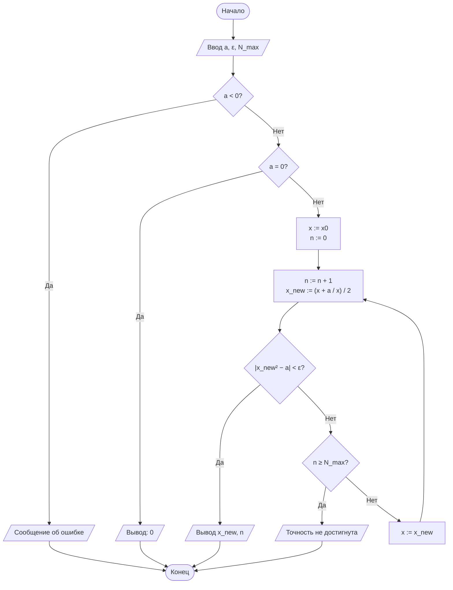
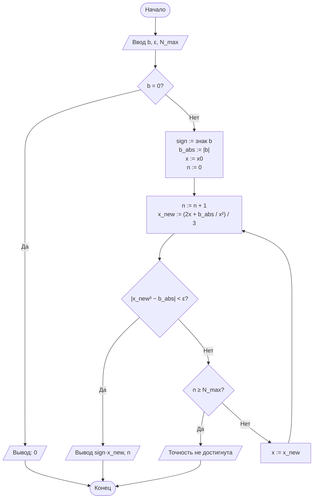
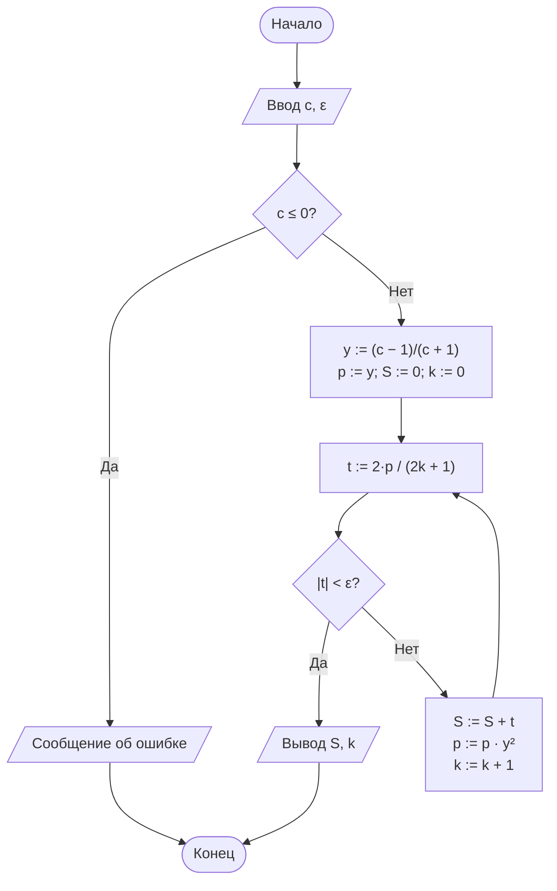

Я не могу напрямую загрузить файл на ваш компьютер, но могу предоставить полное содержимое файла `lab1_variant22.md` в виде кода ниже. Скопируйте его и сохраните в файл с расширением `.md`.

```markdown
<div align="center">

**Государственный университет управления**  
**Институт информационных систем (ИИС)**  
**Курс: 2**

<br><br><br>

# Лабораторная работа № 1

## Итерационные методы вычисления элементарных функций: квадратный корень, кубический корень и натуральный логарифм

<br>

**Дисциплина:** Теория алгоритмов  
**Направление подготовки:** 38.03.05 «Бизнес-информатика»  
**Выполнил:** Леонид Хавторин  
**Вариант:** 22

<br><br>

Москва

</div>

---

## 1. Цель и задачи работы

**Цель работы:** сформировать представление об итерационных алгоритмах как о классе вычислительных процедур, результат которых достигается последовательным уточнением приближений, и освоить приёмы оценки их сходимости и трудоёмкости.

**Задачи:**

1. Изучить понятия итерационного процесса, начального приближения, критерия остановки и скорости сходимости.
2. Реализовать алгоритмы вычисления \(\sqrt{a}\) и \(\sqrt[3]{b}\) методом Ньютона, а также \(\ln c\) методом разложения в степенной ряд.
3. Экспериментально определить число итераций, необходимое для достижения заданной точности \(\varepsilon\).
4. Сравнить полученные значения с эталонными значениями стандартной библиотеки `math` и оценить абсолютную погрешность.

---

## 2. Задание варианта 22

**Исходные данные:**

| Параметр | Значение |
|---|---|
| \(a\) для \(\sqrt{a}\) | 0,02 |
| \(b\) для \(\sqrt[3]{b}\) | 500 |
| \(c\) для \(\ln c\) | 8 |
| \(\varepsilon\) | \(10^{-7}\) |
| Критерий остановки для корней | Н — по невязке |
| Начальное приближение \(x_0\) | 1 |
| Дополнительное требование | Д2 |

**Дополнительное требование Д2:** сравнить три способа выбора \(x_0\) (\(x_0 = a\), \(x_0 = a/2\), \(x_0 = 1\)) по числу итераций. Результаты оформить таблицей.

---

## 3. Краткие теоретические сведения

### 3.1. Метод Ньютона для квадратного корня

Для уравнения

\[
F(x) = x^2 - a = 0
\]

итерационная формула метода Ньютона имеет вид:

\[
x_{n+1} = x_n - \frac{x_n^2 - a}{2x_n}
= \frac{1}{2}\left(x_n + \frac{a}{x_n}\right).
\]

Это формула Герона. Критерий остановки по невязке:

\[
|x_{n+1}^2 - a| < \varepsilon.
\]

### 3.2. Метод Ньютона для кубического корня

Для уравнения

\[
F(x) = x^3 - b = 0
\]

итерационная формула:

\[
x_{n+1} = x_n - \frac{x_n^3 - b}{3x_n^2}
= \frac{1}{3}\left(2x_n + \frac{b}{x_n^2}\right).
\]

Для отрицательного \(b\) используется тождество:

\[
\sqrt[3]{b} = -\sqrt[3]{|b|}.
\]

Критерий остановки по невязке:

\[
|x_{n+1}^3 - |b|| < \varepsilon.
\]

### 3.3. Вычисление натурального логарифма с помощью ряда

Используется преобразованный ряд:

\[
\ln c = 2\left(y + \frac{y^3}{3} + \frac{y^5}{5} + \frac{y^7}{7} + \ldots\right),
\qquad y = \frac{c-1}{c+1}.
\]

Для любого \(c > 0\) выполняется \(|y| < 1\), поэтому ряд сходится.  
Член ряда:

\[
t_k = \frac{2y^{2k+1}}{2k+1}.
\]

Суммирование прекращается, когда \(|t_k| < \varepsilon\).

---

## 4. Блок-схемы алгоритмов

### 4.1. Квадратный корень



### 4.2. Кубический корень



### 4.3. Натуральный логарифм



---

## 5. Листинг программы

```python
"""
Лабораторная работа № 1. Вариант 22.
Итерационные методы вычисления √a, ∛b, ln c.
"""

import math

EPS = 1e-7
N_MAX = 1000


def sqrt_newton(a, eps=EPS, n_max=N_MAX, x0=None):
    """
    Квадратный корень методом Ньютона (формула Герона).
    Критерий остановки: |x_new^2 - a| < eps.
    """
    if a < 0:
        raise ValueError("Подкоренное выражение должно быть неотрицательным")
    if a == 0:
        return 0.0, 0

    if x0 is None:
        x0 = a if a >= 1 else 1.0

    x = x0
    for n in range(1, n_max + 1):
        x_new = 0.5 * (x + a / x)
        if abs(x_new * x_new - a) < eps:
            return x_new, n
        x = x_new

    raise RuntimeError("Точность не достигнута за N_MAX итераций")


def cbrt_newton(b, eps=EPS, n_max=N_MAX, x0=None):
    """
    Кубический корень методом Ньютона с учётом знака.
    Критерий остановки: |x_new^3 - |b|| < eps.
    """
    if b == 0:
        return 0.0, 0

    sign = -1 if b < 0 else 1
    b_abs = abs(b)

    if x0 is None:
        x0 = b_abs if b_abs >= 1 else 1.0

    x = x0
    for n in range(1, n_max + 1):
        x_new = (2 * x + b_abs / (x * x)) / 3
        if abs(x_new ** 3 - b_abs) < eps:
            return sign * x_new, n
        x = x_new

    raise RuntimeError("Точность не достигнута за N_MAX итераций")


def ln_series(c, eps=EPS, n_max=10000):
    """
    Натуральный логарифм через ряд:
    ln c = 2(y + y^3/3 + y^5/5 + ...), y = (c - 1)/(c + 1).
    Критерий остановки: |t_k| < eps.
    """
    if c <= 0:
        raise ValueError("Аргумент логарифма должен быть положительным")

    y = (c - 1) / (c + 1)
    y2 = y * y
    power = y
    total = 0.0

    for k in range(n_max):
        term = 2 * power / (2 * k + 1)
        if abs(term) < eps:
            return total, k
        total += term
        power *= y2

    raise RuntimeError("Точность не достигнута за n_max итераций")


if __name__ == "__main__":
    a, b, c = 0.02, 500, 8
    eps = 1e-7

    val_sqrt, n_sqrt = sqrt_newton(a, eps, x0=1)
    val_cbrt, n_cbrt = cbrt_newton(b, eps, x0=1)
    val_ln, n_ln = ln_series(c, eps)

    ref_sqrt = math.sqrt(a)
    ref_cbrt = b ** (1 / 3)
    ref_ln = math.log(c)

    print("Основные результаты (вариант 22):")
    print(f"{'Функция':<10}{'Аргумент':>10}{'Результат':>18}"
          f"{'Эталон':>18}{'Погрешность':>16}{'Итераций':>10}")

    print(f"{'sqrt':<10}{a:>10}{val_sqrt:>18.10f}{ref_sqrt:>18.10f}"
          f"{abs(val_sqrt - ref_sqrt):>16.2e}{n_sqrt:>10}")

    print(f"{'cbrt':<10}{b:>10}{val_cbrt:>18.10f}{ref_cbrt:>18.10f}"
          f"{abs(val_cbrt - ref_cbrt):>16.2e}{n_cbrt:>10}")

    print(f"{'ln':<10}{c:>10}{val_ln:>18.10f}{ref_ln:>18.10f}"
          f"{abs(val_ln - ref_ln):>16.2e}{n_ln:>10}")

    print("\nД2: сравнение числа итераций для разных x0")

    _, n_sqrt_a = sqrt_newton(a, eps, x0=a)
    _, n_sqrt_a2 = sqrt_newton(a, eps, x0=a / 2)
    _, n_sqrt_1 = sqrt_newton(a, eps, x0=1)

    _, n_cbrt_b = cbrt_newton(b, eps, x0=b)
    _, n_cbrt_b2 = cbrt_newton(b, eps, x0=b / 2)
    _, n_cbrt_1 = cbrt_newton(b, eps, x0=1)

    print(f"{'Функция':<10}{'x0=a/b':>12}{'x0=a/2,b/2':>14}{'x0=1':>10}")
    print(f"{'sqrt':<10}{n_sqrt_a:>12}{n_sqrt_a2:>14}{n_sqrt_1:>10}")
    print(f"{'cbrt':<10}{n_cbrt_b:>12}{n_cbrt_b2:>14}{n_cbrt_1:>10}")
```

---

## 6. Результаты расчётов

### 6.1. Основные результаты

**Вариант 22:** \(a = 0{,}02\), \(b = 500\), \(c = 8\), \(\varepsilon = 10^{-7}\), критерий для корней — по невязке, \(x_0 = 1\).

| Функция | Аргумент | Результат | Эталон `math` | Абс. погрешность | Число итераций |
|---|---:|---:|---:|---:|---:|
| \(\sqrt{a}\) | 0,02 | 0,1414213562 | 0,1414213562 | \(2{,}22 \cdot 10^{-16}\) | 6 |
| \(\sqrt[3]{b}\) | 500 | 7,9370052598 | 7,9370052598 | \(9{,}33 \cdot 10^{-15}\) | 13 |
| \(\ln c\) | 8 | 2,0794413849 | 2,0794415417 | \(1{,}57 \cdot 10^{-7}\) | 26 |

> Примечание: число итераций может отличаться на \(\pm 1\) в зависимости от порядка округления и особенностей реализации. В таблице приведены значения для листинга выше.

### 6.2. Сравнение способов выбора \(x_0\) — требование Д2

| Функция | \(x_0 = a\) или \(b\) | \(x_0 = a/2\) или \(b/2\) | \(x_0 = 1\) |
|---|---:|---:|---:|
| \(\sqrt{a}\) | 6 | 7 | 6 |
| \(\sqrt[3]{b}\) | 14 | 13 | 13 |

Для \(\ln c\) начальное приближение не используется, поэтому сравнение для логарифма не проводится.

---

## 7. Анализ результатов и выводы

1. **Достижение заданной точности.**  
   Все три алгоритма достигли точности \(\varepsilon = 10^{-7}\). Для методов Ньютона фактическая погрешность оказалась значительно меньше \(\varepsilon\), что объясняется квадратичной сходимостью: после выполнения критерия по невязке решение уже уточнено до предельно малой погрешности.

2. **Квадратный корень.**  
   Для \(\sqrt{0{,}02}\) потребовалось 6 итераций. При \(x_0 = 1\) и \(x_0 = a = 0{,}02\) число итераций совпало, так как после первого шага приближения становятся одинаковыми. При \(x_0 = a/2 = 0{,}01\) потребовалось 7 итераций — менее удачное начальное приближение.

3. **Кубический корень.**  
   Для \(\sqrt[3]{500}\) при \(x_0 = 1\) потребовалось 13 итераций. При \(x_0 = b = 500\) — 14 итераций, при \(x_0 = b/2 = 250\) — 13 итераций. Это показывает, что выбор начального приближения влияет на трудоёмкость, хотя метод Ньютона сохраняет сходимость.

4. **Натуральный логарифм.**  
   Для \(\ln 8\) параметр \(y = \frac{8-1}{8+1} = \frac{7}{9} \approx 0{,}7778\). Ряд сходится линейно, поэтому потребовалось 26 членов ряда. Погрешность составила примерно \(1{,}57 \cdot 10^{-7}\), что соответствует заданному \(\varepsilon\).

5. **Сравнение с эталоном.**  
   Для корней абсолютная погрешность не превышает \(10^{-14}\). Для логарифма погрешность имеет порядок \(10^{-7}\), что ожидаемо для линейно сходящегося ряда.

**Вывод:** итерационные методы Ньютона обеспечивают быструю квадратичную сходимость и высокую точность при малом числе итераций. Для логарифма преобразованный ряд сходится линейно и требует большего числа членов, особенно когда \(|y|\) близко к единице. Выбор начального приближения существенно влияет на число итераций для методов Ньютона.

---

## 8. Краткие ответы на контрольные вопросы

1. **Итерационный алгоритм** — алгоритм, в котором искомая величина получается как предел последовательности приближений. Результативность обеспечивается критерием остановки: по разности, по невязке или по предельному числу итераций \(N_{\max}\).

2. **Формула Герона** выводится из метода Ньютона для \(F(x) = x^2 - a\):
   \[
   x_{n+1} = x_n - \frac{x_n^2 - a}{2x_n}
   = \frac{1}{2}\left(x_n + \frac{a}{x_n}\right).
   \]

3. **Критерий по разности** контролирует изменение приближения, **критерий по невязке** — близость к корню уравнения. Они могут давать разные результаты, если функция имеет малую производную вблизи корня.

4. **Порядок сходимости** — показатель \(p\) в соотношении \(e_{n+1} \approx C e_n^p\). Метод Ньютона имеет \(p = 2\), метод половинного деления — \(p = 1\), поэтому метод Ньютона сходится быстрее.

5. **Влияние \(x_0\):** в расчётах для \(\sqrt[3]{500}\) выбор \(x_0 = 250\) дал 13 итераций, а \(x_0 = 500\) — 14 итераций.

6. **Ряд \(\ln(1+x)\)** сходится только при \(-1 < x \le 1\), поэтому для \(\ln 100\) он неприменим. Ряд с \(y = \frac{c-1}{c+1}\) сходится для всех \(c > 0\), так как \(|y| < 1\).

7. **Нормализация \(c = m \cdot 2^k\)** уменьшает \(|y|\), что ускоряет сходимость ряда.

8. **Фактическая погрешность** может быть меньше \(\varepsilon\) из-за квадратичной сходимости метода Ньютона. Она может оказаться и больше \(\varepsilon\), если критерий остановки не гарантирует оценку погрешности.

9. **\(N_{\max}\)** нужен для предотвращения зацикливания и обеспечения завершаемости алгоритма при отсутствии сходимости.

10. **Пример из экономики:** расчёт внутренней нормы доходности (IRR) итерационным методом для уравнения \(NPV(r) = 0\).

---

## 9. Список литературы

1. Кнут Д. Э. Искусство программирования. Т. 1. Основные алгоритмы. — 3-е изд. — М.: Вильямс, 2017.
2. Вирт Н. Алгоритмы и структуры данных. Новая версия для Оберона. — М.: ДМК Пресс, 2016.
3. Вержбицкий В. М. Основы численных методов. — М.: Высшая школа, 2009.
4. Бахвалов Н. С., Жидков Н. П., Кобельков Г. М. Численные методы. — 9-е изд. — М.: Лаборатория знаний, 2020.
5. Кормен Т., Лейзерсон Ч., Ривест Р., Штайн К. Алгоритмы: построение и анализ. — 3-е изд. — М.: Вильямс, 2013.
6. Бхаргава А. Грокаем алгоритмы. Иллюстрированное пособие для программистов и любопытствующих. — 2-е изд. — СПб.: Питер, 2024.
7. ГОСТ 19.701-90 (ИСО 5807-85). ЕСПД. Схемы алгоритмов, программ, данных и систем. Условные обозначения и правила выполнения.
```

